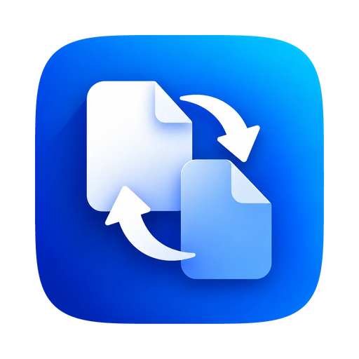

<p align="center">
  
</p>

<h1 align="center">Trasmuta</h1>

<p align="center">
  <b>Il convertitore di file che si apre sotto il cursore.</b><br>
  Trascina uno o più file tenendo premuto un tasto, lasciali sul formato che vuoi: fatto.
</p>

---

## Perché Trasmuta

- **Niente finestre da aprire.** Il menu dei formati compare dove si trova già il mouse, e mostra solo i formati
  sensati per i file che stai trascinando.
- **Quattro stili di menu.** Cerchio, Ventaglio, Elenco o Griglia: scegli quello che ti è più comodo in
  **Theme → Menu style** (Tema → Stile menu). L'anteprima mostra subito come apparirà.
- **Tastiera ovunque.** In ogni stile i tasti <kbd>1</kbd>–<kbd>9</kbd> scelgono un formato, le frecce si spostano,
  <kbd>Invio</kbd> converte, <kbd>Esc</kbd> chiude. <kbd>Tab</kbd> (o la rotella) passa ai formati meno usati.
- **Tutto resta sul tuo computer.** Nessun file viene caricato online: la conversione avviene in locale e il
  risultato viene salvato accanto all'originale.
- **Centinaia di formati.** Immagini, PDF, documenti Office, fogli di calcolo, presentazioni, HWP, e-book, video,
  audio, sottotitoli, archivi, font, CAD, modelli 3D e dati geografici.

## Come si usa

1. Tieni premuto <kbd>Option</kbd> (su Windows e Linux <kbd>Ctrl</kbd>) e trascina dei file dal Finder.
2. Sotto il cursore si apre il menu con i formati adatti.
3. Lascia i file sul formato desiderato: un anello mostra l'avanzamento e il file convertito compare accanto
   all'originale.

Altri modi per aprire il menu: la scorciatoia da tastiera sui file selezionati, la voce **Converti con Trasmuta**
nel menu contestuale del Finder e la zona di rilascio nella schermata Home.

Ogni tipo di file ha il suo menu, con preset per qualità, dimensioni, DPI, pagine PDF, compressione, video e audio,
cartella di destinazione e nome dei file. I preset si riordinano trascinandoli nella pagina **Donut toolbar** (barra del menu).

## Formati principali

| Da | A |
|---|---|
| **Immagini**: JPG, PNG, WEBP, AVIF, HEIC, TIFF, GIF, PSD, RAW delle fotocamere, … | tra loro, PDF, ICO/ICNS, SVG (vettorializzazione) |
| **PDF** | DOCX, TXT, immagini, unione, divisione, compressione |
| **Documenti, fogli, presentazioni**: DOCX, XLSX, PPTX, ODT, Pages, Numbers, Keynote, … | PDF, DOCX, XLSX, CSV, immagini, … |
| **Video e audio**: MP4, MOV, MKV, MP3, WAV, FLAC, … | MP4, WEBM, GIF, MP3, M4A, FLAC, … |
| **Archivi**: ZIP, 7Z, RAR, TAR, DMG, ISO, … | estrazione, ZIP, 7Z, TAR |
| **Altro**: e-book, sottotitoli, font, CAD (DWG/DXF), modelli 3D, dati geografici | tra loro e formati comuni |

Alcune conversioni usano motori opzionali (FFmpeg, LibreOffice, Ghostscript, Pandoc, calibre) che Trasmuta scarica
dalle fonti ufficiali solo quando servono. I dettagli sono in [docs/ENGINES.md](docs/ENGINES.md).

## Scarica

La guida completa, con aggiornamento, disinstallazione e soluzione dei problemi, è in
[docs/INSTALLAZIONE.md](docs/INSTALLAZIONE.md).

1. Apri la pagina [Releases](https://github.com/Pietro310/Trasmuta/releases/latest) e scarica lo zip per il tuo Mac:
   `osx-arm64` per Apple Silicon (M1, M2, M3, …), `osx-x64` per i Mac Intel.
2. Apri lo zip e trascina **Trasmuta.app** nella cartella Applicazioni.
3. Al primo avvio macOS la blocca perché non è firmata da Apple: vai in Impostazioni di Sistema → Privacy e sicurezza
   e scegli **Apri comunque**. Serve una volta sola.
4. Concedi a Trasmuta i permessi **Accessibilità** (per i gesti) e **Automazione del Finder** (per leggere la
   selezione) quando li chiede.

Quando esce una nuova versione Trasmuta te lo segnala: scarica il nuovo zip e sostituisci l'app in Applicazioni. Le
impostazioni e i permessi restano. Il controllo si può disattivare in **About → Updates** (Informazioni → Aggiornamenti).

## Compilare da sé

Serve il [.NET 10 SDK](https://dotnet.microsoft.com/download) (con Homebrew: `brew install --cask dotnet-sdk`).

```bash
build/build-trasmuta-macos.sh --install
```

Lo script compila l'app, la firma localmente e la installa in `~/Applications/Trasmuta.app`. Al primo avvio concedi
a Trasmuta i permessi **Accessibilità** (per i gesti) e **Automazione del Finder** (per leggere la selezione) in
Impostazioni di Sistema → Privacy e sicurezza.

## Sviluppo

```bash
dotnet run --project src/Filee.App      # avvia l'app dal codice
dotnet test                              # esegue i test
```

- [Guida per lo sviluppo](CONTRIBUTING.md)
- [Architettura](docs/ARCHITECTURE.md) · [Motori di conversione](docs/ENGINES.md) ·
  [Aggiungere un convertitore](docs/ADDING-A-CONVERTER.md) · [Aggiungere una lingua](docs/ADDING-A-LANGUAGE.md) ·
  [Temi personalizzati](docs/CUSTOM-THEMES.md)

## Licenza

Trasmuta è software libero distribuito con licenza MIT: vedi [LICENSE](LICENSE). I componenti di terze parti
inclusi mantengono le proprie licenze, elencate in [THIRD-PARTY-NOTICES.md](THIRD-PARTY-NOTICES.md) e nella
pagina Informazioni dell'app.

© 2026 Pietro310
